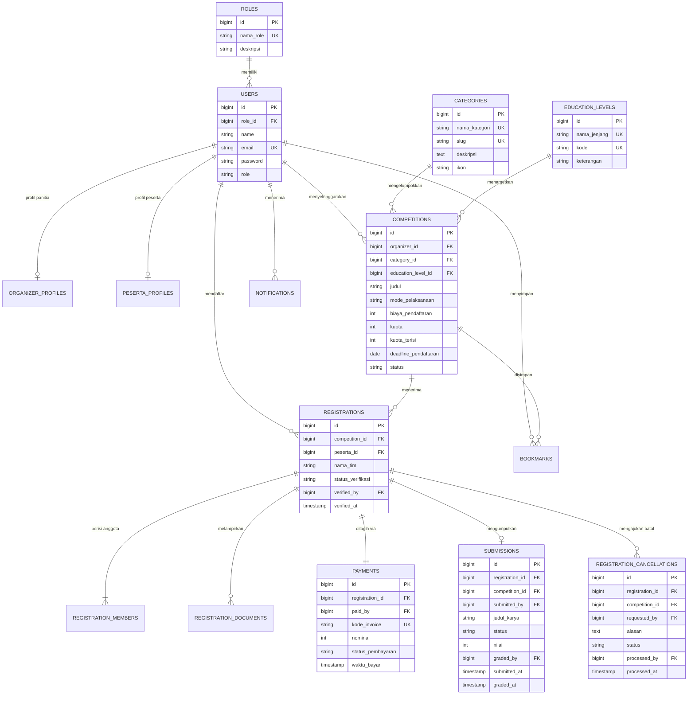

# OLIMFY — Platform Terpadu Publikasi & Manajemen Kompetisi

Proyek UAS Praktikum **Pengembangan Perangkat Lunak Web (Framework) Ganjil 2026/2027** berbasis **Laravel** dan **PostgreSQL**.

**Olimfy** adalah aplikasi web yang mempertemukan penyelenggara perlombaan/olimpiade dengan peserta (pelajar & mahasiswa) dalam satu platform terstruktur: mulai dari penemuan lomba, pendaftaran tim beserta berkas identitas, simulasi pembayaran invoice, verifikasi kurasi panitia, pengumpulan & penilaian karya, pembatalan pendaftaran, hingga laporan rekapitulasi penyelenggara.

---

## 👥 Anggota Kelompok & Pembagian Peran (Lampiran B)

| No | NIM | Nama Lengkap | Peran & Fokus | Master / Transaksi | Bagian yang Dikerjakan |
|:--:|:---:|:---|:---|:---|:---|
| 1 | `434251026` | **Ahmad Shafy Al Rahman** | Backend Registrasi, Karya, Laporan & Testing | **T1, T3, T4**, Laporan Query Builder | Global Helpers, T1 Pendaftaran Tim (Header-Detail `DB::transaction()`), T3 Pembayaran Invoice (`paid_by`), T4 Pengumpulan & Penilaian Karya (`submissions`), Laporan Rekap Query Builder, Feature Tests, `README.md` & ERD, Docker |
| 2 | `434251025` | **Syauqi Hafid Athallah** | Arsitektur AdminLTE 4, Auth & RBAC, Master Data | **M1, M3**, **T2** | Master Layout AdminLTE 4 & Partials, Autentikasi & RBAC (`roles` + HTTP `403`), Seeder Akun, M1 Kategori Lomba (`categories`), M3 Kompetisi (`competitions`), T2 Verifikasi Berkas (`verified_by`, `verified_at`, pulihkan kuota) |
| 3 | `434251035` | **Muhammad Hikam Badriddujaa** | Layout Publik, Katalog, Master Jenjang & Pembatalan | **M2**, **T5** | Master Layout Tamu (`guest`), Halaman Publik (`home`, `explore`, `lomba-detail`), Bookmark (`belongsToMany`), Profil Peserta, M2 Jenjang Pendidikan (`education_levels`), Relasi M1 & M2 ke M3, T5 Pembatalan Pendaftaran (`registration_cancellations`) |

---

## 🗄️ Entity Relationship Diagram (ERD)



---

## 🔐 Matriks Hak Akses (Lampiran A)

Keterangan: **C** = Create, **R** = Read, **U** = Update, **D** = Delete, **-** = Tidak ada akses (Guest dialihkan ke `/login`; user login dengan role tidak sesuai menerima HTTP **403**).

| Fitur | Guest | Role 2 (`peserta`) | Role 1 (`penyelenggara`) |
| :--- | :---: | :---: | :---: |
| **M1 Kategori Lomba (`categories`)** | R | R | C R U D |
| **M2 Jenjang Pendidikan (`education_levels`)** | R | R | C R U D |
| **M3 Kompetisi / Lomba (`competitions`)** | R | R | C R U D |
| **T1 Pendaftaran Tim (Header-Detail)** | - | C R (miliknya) | R |
| **T2 Verifikasi & Kurasi Berkas** | - | R (miliknya) | U |
| **T3 Pembayaran Tagihan Invoice** | - | C R U (miliknya) | R |
| **T4 Pengumpulan & Penilaian Karya** | - | C R U (miliknya) | R U |
| **T5 Pengajuan Pembatalan Pendaftaran** | - | C R (miliknya) | R U |
| **Laporan Rekap (Query Builder)** | - | - | R |

---

## 📚 Daftar Data Master & Transaksi

### Tiga Data Master
1. **M1 — Kategori Lomba (`categories`)**: Referensi bidang lomba (Teknologi, Desain, Bisnis, Sains). Mendukung CRUD penuh, pencarian, pagination, dan pencegahan hapus bila masih digunakan oleh kompetisi.
2. **M2 — Jenjang Pendidikan (`education_levels`)**: Referensi jenjang sasaran peserta (SMA/SMK, Mahasiswa, Umum, SMP/MTs). Mendukung CRUD penuh, pencarian, pagination, dan pencegahan hapus bila masih dipakai oleh kompetisi.
3. **M3 — Kompetisi / Lomba (`competitions`)**: Data kompetisi yang berelasi ke M1 (`category_id`), M2 (`education_level_id`), dan penyelenggara (`organizer_id`). Mendukung CRUD penuh, pencarian, pagination, dan pencegahan hapus bila sudah memiliki transaksi pendaftaran.

### Lima Transaksi Berbeda
1. **T1 — Pendaftaran Tim Kompetisi (`registrations` + `registration_members` + `registration_documents`)**: Transaksi **Header-Detail** yang disimpan dalam `DB::transaction()` (1 pendaftaran tim memuat data ketua, anggota opsional, unggahan KTM/proposal, serta otomatis menerbitkan tagihan awal dan **menambah `kuota_terisi`** pada M3).
2. **T2 — Verifikasi & Kurasi Berkas**: Alur 2 role (*peserta* mendaftar $\rightarrow$ *penyelenggara* menyetujui/menolak). Mencatat pelaku (`verified_by`) dan waktu (`verified_at`); bila ditolak, otomatis **mengembalikan `kuota_terisi`** dan mengirim notifikasi ke peserta.
3. **T3 — Pembayaran Tagihan Invoice (`payments`)**: Konfirmasi pelunasan tagihan pendaftaran dengan pencatatan pelaku (`paid_by`), waktu bayar (`waktu_bayar`), serta pengiriman notifikasi pembayaran lunas.
4. **T4 — Pengumpulan & Penilaian Karya (`submissions`)**: Alur 2 role (*peserta* berstatus lolos & lunas mengunggah karya $\rightarrow$ *penyelenggara* memberi nilai `0-100`, status `dinilai`/`finalis`, dan catatan juri). Mencatat `submitted_by`, `submitted_at`, `graded_by`, `graded_at`, serta mengirim notifikasi hasil penilaian.
5. **T5 — Pengajuan Pembatalan Pendaftaran (`registration_cancellations`)**: Alur 2 role (*peserta* mengajukan pembatalan beserta alasan $\rightarrow$ *penyelenggara* menyetujui/menolak). Bila disetujui, status registrasi berubah menjadi `dibatalkan`, **`kuota_terisi` pada M3 berkurang**, dan notifikasi dikirim ke peserta.

### Laporan Rekapitulasi (Query Builder)
* **`ReportController@index`** (`/penyelenggara/laporan`): Dibangun menggunakan `DB::table('competitions')` dengan `join`, `leftJoin`, `groupBy`, dan agregasi SQL (`COUNT`, `SUM`, `AVG`) untuk menampilkan rekap total pendaftar, jumlah lolos, jumlah ditolak, total pendapatan lunas, dan rata-rata skor karya per kompetisi serta per kategori.

---

## 💻 Cara Instalasi & Menjalankan Aplikasi

### Opsi 1: Lokal (PHP 8.3+ & PostgreSQL)

1. **Clone repository dan masuk ke direktori proyek:**
   ```bash
   git clone https://github.com/MHikamB/Olimfy-framework.git
   cd Olimfy-framework
   ```

2. **Pasang dependensi PHP:**
   ```bash
   composer install
   ```

3. **Siapkan konfigurasi environment:**
   ```bash
   cp .env.example .env
   php artisan key:generate
   ```
   Sesuaikan koneksi **PostgreSQL** pada berkas `.env`:
   ```env
   DB_CONNECTION=pgsql
   DB_HOST=127.0.0.1
   DB_PORT=5432
   DB_DATABASE=olimfy_db
   DB_USERNAME=postgres
   DB_PASSWORD=password_anda
   ```
   *(Pastikan database `olimfy_db` sudah dibuat di PostgreSQL).*

4. **Jalankan migrasi, seeder, dan symbolic link storage:**
   ```bash
   php artisan migrate:fresh --seed
   php artisan storage:link
   ```

5. **Jalankan server pengembangan:**
   ```bash
   php artisan serve
   ```
   Akses aplikasi di browser melalui `http://127.0.0.1:8000`.

6. **Menjalankan Pengujian Otomatis:**
   ```bash
   php artisan test
   ```

---

### Opsi 2: Menggunakan Docker (Opsional)

1. **Jalankan container aplikasi & PostgreSQL:**
   ```bash
   docker compose up -d --build
   ```
2. **Jalankan migrasi, seeder, dan storage link di dalam container:**
   ```bash
   docker compose exec app cp .env.example .env
   docker compose exec app php artisan key:generate
   docker compose exec app php artisan migrate:fresh --seed
   docker compose exec app php artisan storage:link
   ```
3. Akses aplikasi melalui `http://localhost:8000`.

---

## 🔑 Daftar Akun Seeder

| Role | Nama | Email | Password |
| :--- | :--- | :--- | :--- |
| **Penyelenggara (Role 1)** | ITB STEI Panitia Informatika | `panitia@stei.itb.ac.id` | `password123` |
| **Peserta (Role 2)** | Muhammad Rayhan Pratama | `rayhan.pratama@example.com` | `password123` |
